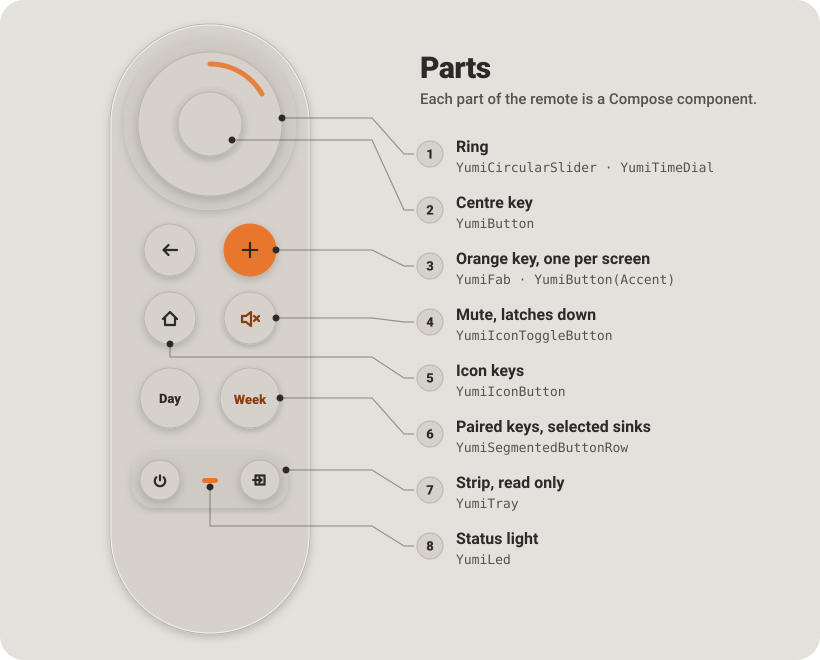

<h1 align="center">Casual Yumi</h1>

<p align="center">Matte, soft-touch components for Jetpack Compose, modelled on a TV remote.</p>

<p align="center">
  <a href="https://vladlazarean.github.io/casual-yumi/"><b>Try every component in the interactive playground</b></a>
</p>

<p align="center">
  <picture>
    <source media="(prefers-color-scheme: dark)" srcset="docs/assets/parts-graphite.svg">
    
  </picture>
</p>

I wanted a clean, modern, elegant design, and the Chromecast remote gave me the inspiration: round soft keys that sink when you press them, a big ring on top, and one key that stands apart from the rest. I made that key orange and turned the whole remote into Compose components.

Two themes, Putty (light) and Graphite (dark), five accents or your own, and 76 components that all follow the same four rules.

## Install

Served by [JitPack](https://jitpack.io/#vladlazarean/casual-yumi). No account, no token. Your app needs `minSdk = 24` and `compileSdk = 37` (Compose 1.12).

```kotlin
// settings.gradle.kts
dependencyResolutionManagement {
    repositories {
        google()
        mavenCentral()
        maven("https://jitpack.io")
    }
}
```

```kotlin
// app/build.gradle.kts
dependencies {
    implementation("com.github.vladlazarean.casual-yumi:yumi-components:0.0.9")
}
```

Then wrap your app in `YumiTheme`. Every parameter is optional.

```kotlin
YumiTheme(darkTheme = isSystemInDarkTheme(), accent = YumiAccent.Orange) {
    App()
}
```

## Packages

`yumi-components` pulls in the other two, so the one line above is all you need.

| Package | What it is |
|---|---|
| `yumi-components` | All 76 UI components listed below. |
| `yumi-foundation` | `YumiTheme`, the Material 3 mapping, the Manrope type scale, and the material itself: `Modifier.pebble()` for raised keys, `Modifier.tray()` for recessed panels, the press sink and haptics. Use it to build your own controls. |
| `yumi-tokens` | Raw design values as plain Compose types, with no `android.*` APIs: colours for both themes, the accent presets, depth, shapes and motion, plus a WCAG contrast checker for custom accents. |
| `yumi-bom` | Optional. Keeps the three packages on the same version if you depend on more than one directly. |

## The four rules

- **Raised means press it.** Recessed means read it. A tray never takes a tap.
- **Orange is scarce.** One accent action per screen, plus the lights that say something is on.
- **Selected means sunk.** Selected keys rest pushed in with orange ink, never an orange fill.
- **A press is a sink.** Keys drop and swap their shadow. No ripples anywhere, even on stock Material components inside `YumiTheme`.

## Examples

A primary action and its neutral partner:

```kotlin
@Composable
fun AlarmActions(onDismiss: () -> Unit, onSnooze: () -> Unit) {
    Row(horizontalArrangement = Arrangement.spacedBy(12.dp)) {
        YumiButton(onClick = onDismiss, variant = YumiButtonVariant.Accent) { Text("Dismiss") }
        YumiButton(onClick = onSnooze) { Text("Snooze") }
    }
}
```

A list row with a switch:

```kotlin
@Composable
fun AlarmRow() {
    var armed by remember { mutableStateOf(true) }
    YumiListItem(
        headlineContent = { Text("07:30") },
        supportingContent = { Text("Weekdays") },
        trailingContent = { YumiSwitch(checked = armed, onCheckedChange = { armed = it }) },
    )
}
```

A slider and a segmented row:

```kotlin
@Composable
fun SoundSettings() {
    var volume by remember { mutableFloatStateOf(0.4f) }
    var period by remember { mutableStateOf("Week") }
    Column(verticalArrangement = Arrangement.spacedBy(16.dp)) {
        YumiSlider(value = volume, onValueChange = { volume = it }, steps = 9)
        YumiSegmentedButtonRow(
            options = listOf("Day", "Week", "Month"),
            selected = period,
            onSelect = { period = it },
        ) { Text(it) }
    }
}
```

The time dial. The inner ring sets hours, the outer ring sets minutes:

```kotlin
@Composable
fun WakeUpTime() {
    var hour by remember { mutableIntStateOf(7) }
    var minute by remember { mutableIntStateOf(30) }
    YumiTimeDial(hour = hour, minute = minute, onTimeChange = { h, m -> hour = h; minute = m })
}
```

A text field, a read-only tray and a status light:

```kotlin
@Composable
fun AlarmDetails() {
    var name by remember { mutableStateOf("Morning run") }
    Column(verticalArrangement = Arrangement.spacedBy(16.dp)) {
        YumiTextField(value = name, onValueChange = { name = it }, label = "Alarm name", supportingText = "Shown on the lock screen")
        YumiTray {
            Row(verticalAlignment = Alignment.CenterVertically, horizontalArrangement = Arrangement.spacedBy(8.dp)) {
                YumiLed(on = true, contentDescription = "Alarm armed")
                Text("Next alarm 07:30")
            }
        }
    }
}
```

A toast with an undo action, and a confirmation dialog:

```kotlin
@Composable
fun DeleteAlarm(onDelete: () -> Unit, onUndo: () -> Unit) {
    val toasts = remember { YumiToastHostState() }
    val scope = rememberCoroutineScope()
    var confirming by remember { mutableStateOf(false) }
    Box(Modifier.fillMaxSize()) {
        YumiButton(onClick = { confirming = true }) { Text("Delete") }
        YumiToastHost(toasts, Modifier.align(Alignment.BottomCenter))
    }
    if (confirming) {
        YumiAlertDialog(
            onDismissRequest = { confirming = false },
            title = "Delete alarm?",
            text = "You can undo this for a few seconds.",
            confirmLabel = "Delete",
            onConfirm = {
                confirming = false
                onDelete()
                scope.launch {
                    if (toasts.show("Alarm deleted", actionLabel = "Undo") == YumiToastResult.ActionPerformed) onUndo()
                }
            },
            dismissLabel = "Cancel",
        )
    }
}
```

## Customize

Every `YumiTheme` parameter is optional. The ones you are most likely to change:

```kotlin
@Composable
fun QuietApp(content: @Composable () -> Unit) {
    YumiTheme(
        accent = YumiAccent.Sage,                       // Orange (default), Amber, Sage, Sky or Coral
        haptics = rememberYumiHaptics(enabled = false), // or YumiHaptics.None
        motion = YumiMotion(reduceMotion = true),       // also turns on by itself when the system disables animations
        fontFamily = FontFamily.SansSerif,              // Manrope by default, through downloadable fonts
        content = content,
    )
}
```

Your own accent needs a light and a dark set of tones: the key colour, the content drawn on it, and the ink used for selected text. Check it in a unit test, since the theme won't refuse a low-contrast accent at runtime:

```kotlin
val Teal = YumiAccent.custom(
    name = "Teal",
    light = YumiAccentTones(accent = Color(0xFF3FA79C), onAccent = Color(0xFF2B2A28), accentInk = Color(0xFF1C5650)),
    dark = YumiAccentTones(accent = Color(0xFF6CC3B9), onAccent = Color(0xFF1E1F21), accentInk = Color(0xFF6CC3B9)),
)

fun tealPassesContrast(): Boolean = Teal.meetsContrastAA()   // assertTrue(tealPassesContrast()) in your tests
```

Read the theme's values in your own composables through `YumiTheme`: `colors`, `shapes`, `depth`, `motion`, `haptics` and `typography`.

```kotlin
@Composable
fun NextAlarm() {
    Text("07:30", color = YumiTheme.colors.accentInk, style = YumiTheme.typography.titleLarge)
}
```

Build your own key on the same material with `Modifier.pebble()` and `Modifier.pebbleClickable()`. It looks raised, sinks when pressed and plays the theme's haptics, like every built-in key:

```kotlin
@Composable
fun PowerKey(onClick: () -> Unit) {
    val interaction = remember { MutableInteractionSource() }
    val sink by animateSinkAsState(interaction)
    Box(
        Modifier
            .size(56.dp)
            .pebble(
                color = YumiTheme.colors.raised,
                shape = YumiTheme.shapes.icon,
                seatColor = YumiTheme.colors.seat,
                depth = YumiTheme.depth,
                sinkOffset = YumiTheme.motion.sinkOffset,
                sink = { sink },   // read while drawing, so pressing never recomposes
            )
            .pebbleClickable(interaction, enabled = true, role = Role.Button, haptics = YumiTheme.haptics, onClick = onClick),
        contentAlignment = Alignment.Center,
    ) { Text("On") }
}
```

Stock Material 3 components inside `YumiTheme` pick up the palette, shapes and type, and never ripple.

## Components

All 76, grouped as in the [playground](https://vladlazarean.github.io/casual-yumi/#all).

- **Buttons:** `YumiButton`, `YumiIconButton`, `YumiTextButton`, `YumiFab`, `YumiToggleButton`, `YumiIconToggleButton`, `YumiSplitButton`
- **Selection:** `YumiCheckbox`, `YumiTriStateCheckbox`, `YumiRadioButton`, `YumiRadioGroup`, `YumiSwitch`
- **Sliders and dials:** `YumiSlider`, `YumiRangeSlider`, `YumiCircularSlider`, `YumiTimeDial`, `YumiStepper`, `YumiRatingBar`
- **Inputs, chips and segments:** `YumiTextField`, `YumiSecureTextField`, `YumiSearchField`, `YumiSelectField`, `YumiFilterChip`, `YumiAssistChip`, `YumiInputChip`, `YumiSegmentedButtonRow`, `YumiMultiChoiceSegmentedButtonRow`
- **Surfaces and content:** `YumiTray`, `YumiCard`, `YumiLed`, `YumiBadge`, `YumiBadgedBox`, `YumiHorizontalDivider`, `YumiVerticalDivider`, `YumiTooltipBox`, `YumiRichTooltipBox`, `YumiAvatar`, `YumiSkeleton`, `YumiSkeletonLines`, `YumiExpandableSection`, `YumiEmptyState`, `YumiCarousel`, `YumiPagerIndicator`, `YumiDropdownMenu`, `YumiDropdownMenuItem`
- **Feedback:** `YumiLinearProgress`, `YumiCircularProgress`, `YumiToast`, `YumiToastHost`, `YumiSnackbar`, `YumiBanner`
- **Lists, gestures and navigation:** `YumiListItem`, `YumiSwipeToDismiss`, `YumiSwipeActions`, `YumiReorderableColumn`, `YumiDragHandle`, `YumiPullToRefreshBox`, `YumiNavigationRail`, `YumiNavigationRailItem`, `YumiTabRow`, `YumiTab`
- **Screens, bars, sheets and dialogs:** `YumiScaffold`, `YumiTopAppBar`, `YumiNavigationBar`, `YumiNavigationBarItem`, `YumiBottomAppBar`, `YumiModalNavigationDrawer`, `YumiNavigationDrawerItem`, `YumiBottomSheetScaffold`, `YumiModalBottomSheet`, `YumiModalSideSheet`, `YumiDialog`, `YumiAlertDialog`, `YumiTimePickerDialog`, `YumiDatePickerDialog`, `YumiDateRangePickerDialog`

`YumiModalBottomSheet`, `YumiBottomSheetScaffold` and `YumiPullToRefreshBox` take Material state types that Material still marks experimental, so add `@OptIn(ExperimentalMaterial3Api::class)` where you use them.

## Accessibility

Touch targets are at least 48 dp. Every control has a role and state for TalkBack, and every gesture (swipe, reorder, pull to refresh) also has a non-gesture path. Every accent preset passes WCAG AA in both themes, checked by unit tests. RTL, 200 % font scale and reduced motion are supported.

## License

Copyright 2026 Vlad Lazarean. Licensed under [Apache-2.0](LICENSE); see also [NOTICE](NOTICE).
